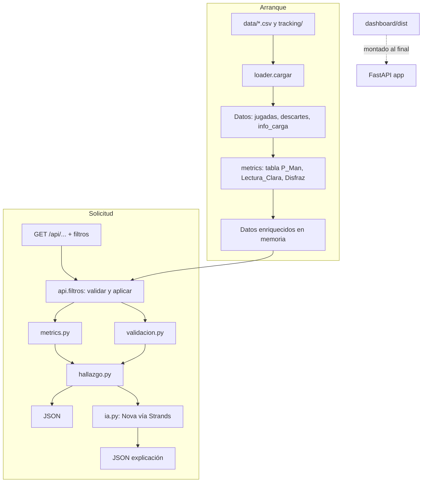

# Documento de Diseño: BackEnd

## Overview

El backend de *Qué tanto delata la defensa su cobertura antes del snap* (punto de vista Coach) es una aplicación FastAPI que, al arrancar, carga una sola vez los datos de la temporada 2021 (semanas 1-8), calcula en memoria la alineación defensiva al snap de cada jugada y expone cifras con n e IC95% bajo `/api/...`.

Pregunta que responde: ¿qué alineación al snap predice Man o Zone, y qué defensas la disfrazan?

Principios de diseño:

- **Todo en memoria, nada en disco.** `cargar()` corre una vez en el arranque (lifespan de FastAPI). Las solicitudes solo filtran y agregan un DataFrame de ≈8,500 filas (Requirement 7).
- **Funciones puras donde importa.** Profundidad, clasificación de descartes, Wilson, contrastes, bootstrap, AUC, Spearman y las reglas de decisión del hallazgo son funciones puras. Eso permite probarlas con propiedades hechas con numpy y semilla fija (sin hypothesis, por `equipo.md`).
- **Criterio fijado antes de ver resultados.** Todos los umbrales viven como constantes de módulo (`MIN_N=30`, `CORTE_MAN=0.50`, `CORTE_ZONE=0.25`, `Z=1.96`, `SEED=2021`, etc.) y no se ajustan (Requirement 4.10).
- **Honestidad estadística.** Todo grupo con n < `MIN_N` devuelve `"n insuficiente"`. Los cortes salieron de una exploración con las mismas semanas, y el hallazgo lo avisa siempre (Requirement 4.9).
- **IA opcional y desacoplada.** `ia.py` solo recibe el JSON del hallazgo; si falla, el resto de la API no cambia (Requirement 8).

### Decisiones y su razón

| Decisión | Razón |
|---|---|
| Leer tracking un archivo a la vez y quedarse solo con el frame del snap | `datos.md`: el tracking completo ocupa 2,534 MB; 23 filas por jugada bastan. |
| Wilson para proporciones, bootstrap solo para medias | Wilson se comporta bien con n pequeño y es calculable en forma cerrada con numpy. |
| P_Man con validación cruzada por paridad de semana | Evita que una jugada contribuya a la tabla que la puntúa, así Lectura_Clara y Disfraz no se inflan. |
| Un `ia.py` aparte con verificación de números | El modelo no puede introducir cifras ajenas al JSON del hallazgo. |
| Validación de filtros en una dependencia común | Mismo comportamiento y mismo 422 en los cinco endpoints de análisis. |

### Investigación y hallazgos que informan el diseño

La investigación se hizo sobre los hechos ya medidos en `.kiro/steering/datos.md` y `requirements.md`:

- Tracking: 122 archivos, 4.9-9.5 MB cada uno; leer 14 columnas con float32 cuesta 4.1 s y 374 MB para todo el tracking, así que leer por archivo y conservar el snap queda por debajo de eso (cifra por confirmar al implementar).
- `playDirection` no está normalizada (right 62,031 filas, left 30,613 en la muestra), por lo que la Profundidad depende de la dirección.
- `ball_snap` existe en 97 de 97 jugadas de la muestra, con 23 filas por jugada; el evento alterno es `autoevent_ballsnap`.
- `pff_passCoverageType`: Zone 5,588, Man 2,481, Other 488 (confirmado). Man y Zone se analizan; Other se descarta aparte.
- `pff_role` usa mayúsculas ('Coverage', 'Pass Rush'...). Las posiciones LCB, RCB, FS, SS salen de la columna de posición de alineación de `pffScoutingData` (nombre exacto sin confirmar; se verifica con `grep` en `EXPLORACION_COLUMNAS.md` en la Fase 0).
- Fuente de la fórmula Wilson: [Wilson score interval, Wikipedia](https://en.wikipedia.org/wiki/Binomial_proportion_confidence_interval#Wilson_score_interval). Content was rephrased for compliance with licensing restrictions.

## Architecture



Estructura de archivos (todo bajo `backend/`, sin carpetas nuevas fuera de `backend/tests/`):

| Archivo | Responsabilidad | Dueño (Fase) |
|---|---|---|
| `loader.py` | Carga, uniones, Profundidad, descartes, `cargar()` | A (1) |
| `metrics.py` | Wilson, contrastes, bootstrap, tabla P_Man, Lectura_Clara, Disfraz, efecto | B (1) |
| `validacion.py` | CV por paridad, AUC, Spearman, permutación, signo de profundidad | C (1) |
| `ia.py` | Explicación con Nova, verificación de números, caché en memoria | D (1) |
| `hallazgo.py` | Reglas de decisión y armado de la frase | G (2) |
| `api.py` | Router `/api/...`, filtros, errores 422 | E (2) |
| `main.py` | `cargar_env`, `app`, lifespan, `/health`, estáticos | E (2) |
| `tests/` | pytest con filas reales | A-F |

Nota: `hallazgo.py` es el módulo de la tarea G del Requirement 9. No se mete en `metrics.py` para que el dueño de cada archivo sea único.

### Flujo de arranque

1. `main.py` ejecuta `cargar_env()` (fragmento literal de `rules.md`) antes de importar boto3 o `ia.py`.
2. El lifespan llama `loader.cargar()`. Si falla, imprime en stdout el archivo o causa y relanza la excepción, así `/health` no responde `ok` (Requirement 7.3).
3. `api.py` calcula una vez los agregados pesados (tabla P_Man por paridad, columnas `p_man_oof`, `lectura`, `disfraz`) y los guarda en `app.state`.
4. Si existe `dashboard/dist`, se monta con `StaticFiles(html=True)` en `/` **después** de registrar `/api` y `/health`, para no interceptarlos.

## Components and Interfaces

### Contratos comunes

```python
# constantes (backend/metrics.py)
MIN_N = 30
Z = 1.96
SEED = 2021
N_BOOT = 2000
N_PERM = 1000
CORTE_MAN = 0.50     # P_Man >= 0.50  -> "parece Man"
CORTE_ZONE = 0.25    # P_Man <= 0.25  -> "parece Zone"
CB_CERCA = 2.0       # tramo_cb <= 2 yd
CB_LEJOS = 6.0       # grupo "lejos": cb_prof > 6 yd
SAF_PROF_MIN = 8.0   # safety profundo: profundidad >= 8 yd
INSUFICIENTE = "n insuficiente"
```

Resultado estadístico estándar (dict JSON-compatible):

```python
# Con n >= MIN_N
{"n": 120, "est": 0.61, "lo": 0.52, "hi": 0.69}
# Con n < MIN_N (incluye 0)
{"n": 12, "est": "n insuficiente", "lo": None, "hi": None}
```

### loader.py

```python
@dataclass
class Datos:
    jugadas: pd.DataFrame          # una fila por jugada retenida
    descartes: dict[str, int]      # motivo -> jugadas
    info_carga: dict[str, float]   # {"segundos": ..., "mb": ...}

def cargar(data_dir: Path | None = None, max_juegos: int | None = None) -> Datos: ...
def profundidad(x, x_balon, direccion) -> np.ndarray: ...
def motivo_descarte(sin_snap, cobertura_other, sin_cb) -> str | None: ...
```

- `data_dir` por defecto es `Path(__file__).resolve().parent.parent / "data"`. `max_juegos` solo se usa en pruebas.
- Columnas de `jugadas`: `gameId, playId, week, defensiveTeam, possessionTeam, down, yardsToGo, passResult, playResult, cobertura, pff_passCoverage, cb_prof, safeties_prof, tramo_cb`.
- Lectura: `usecols`, `float32`/`int32` y `category`.
- Profundidad: `right` → `x - x_balon`; `left` → `x_balon - x`.
- `cb_prof`: media de la Profundidad de los defensores LCB y RCB. `safeties_prof`: conteo de defensores `Coverage` en FS/FSL/FSR/SS/SSL/SSR con Profundidad ≥ 8, recortado a 3.
- `tramo_cb`: `pd.cut` con bordes `[-inf, 2, 4, 6, 8, inf]` y etiquetas `"<=2", "2-4", "4-6", "6-8", ">8"` (cerrado a la derecha).
- Orden de descarte: "sin snap" → "cobertura Other" → "sin CB". "tracking ilegible" es un motivo adicional que aplica a todas las jugadas de un juego cuyo archivo no se puede leer, y se evalúa primero que los otros.
- Frame del snap: el menor `frameId` cuyo `event` sea `ball_snap` o `autoevent_ballsnap`. Se guardan las 23 filas de ese frame.
- Registro con `logging` (avance sobre 122 y conteos). `info_carga` usa `time.perf_counter` y `resource.getrusage` (MB pico, normalizado entre macOS y Linux).
- Invariante: `len(jugadas) + sum(descartes.values()) == len(plays)` (8,557).

### metrics.py

```python
def wilson(k: int, n: int, z: float = Z) -> dict
def contraste_proporciones(k_a, n_a, k_b, n_b, z: float = Z) -> dict
def ic_bootstrap_media(x: np.ndarray, n_boot=N_BOOT, seed=SEED) -> dict
def tabla_p_man(jugadas: pd.DataFrame) -> pd.DataFrame      # por (tramo_cb, safeties_prof)
def p_man_oof(jugadas: pd.DataFrame) -> pd.Series           # validación cruzada por paridad
def marcar_lectura_y_disfraz(jugadas: pd.DataFrame) -> pd.DataFrame
def tell_por_alineacion(jugadas) -> list[dict]
def tasa_disfraz_por_equipo(jugadas) -> list[dict]
def efecto_disfraz(jugadas) -> dict
def aplicar_filtros(jugadas, semana=None, mitad=None, down=None, equipo=None, cobertura=None) -> pd.DataFrame
```

- `wilson`: `p = k/n`, centro `(p + z²/2n) / (1 + z²/n)`, semiancho `z·sqrt(p(1-p)/n + z²/4n²) / (1 + z²/n)`, recortado a [0,1]. Si `n < MIN_N` devuelve el resultado "n insuficiente" (también para n=0, sin división entre cero).
- `contraste_proporciones`: `diff = pA - pB`, `ee = sqrt(pA(1-pA)/nA + pB(1-pB)/nB)`, IC = `diff ± z·ee`. Si algún n < `MIN_N`, "n insuficiente" conservando ambos n.
- `ic_bootstrap_media`: `np.random.default_rng(seed)`, 2,000 remuestreos con reemplazo, percentiles 2.5 y 97.5.
- `p_man_oof`: la P_Man de las jugadas de semana par sale de la tabla construida solo con semanas impares y viceversa. Si una Alineación no existe en la otra paridad, la jugada queda con `p_man_oof = NaN` y su lectura es "ambigua".
- `marcar_lectura_y_disfraz`: `lectura` = "Man" si `p_man_oof ≥ 0.50`, "Zone" si `≤ 0.25`, `NaN` en otro caso. `disfraz = (lectura == "Man" & cobertura == "Zone") | (lectura == "Zone" & cobertura == "Man")`, solo cuando hay lectura.
- `efecto_disfraz`: por grupo, diferencia (Disfraz − sin Disfraz) en % de completos (puntos porcentuales, usa `contraste_proporciones`) y en yardas por jugada (`playResult`, bootstrap sobre la diferencia de medias). Cada grupo con n < `MIN_N` devuelve "n insuficiente".
- `aplicar_filtros`: máscara booleana; filtro `None` = sin filtro.

### validacion.py

```python
def validar(jugadas: pd.DataFrame, seed: int = SEED) -> dict
def auc(score: np.ndarray, y: np.ndarray) -> float
def spearman(a: np.ndarray, b: np.ndarray) -> float
def permutar_cobertura_por_semana(semana, cobertura, rng) -> np.ndarray
```

- `auc`: por rangos con empates promediados (Mann-Whitney), solo numpy.
- `spearman`: rangos con empates promediados + Pearson de rangos.
- `validar` devuelve un dict con cuatro entradas (`validacion_cruzada`, `estabilidad_mitades`, `permutacion`, `signo_profundidad`), cada una con sus valores y `"resultado": "pasa" | "no pasa"`. Cada criterio corre dentro de su propio `try/except`; si falla, devuelve `{"motivo": ..., "resultado": "no pasa"}` y se sigue con los demás.
- Línea base: siempre "Zone". Criterio de validación cruzada: AUC > 0.5 y precisión > línea base en ambas mitades.
- Estabilidad: Spearman de la Tasa_Disfraz por equipo (semanas 1-4 vs 5-8), solo equipos con n ≥ 30 en ambas mitades; si hay menos de 3 equipos, "n insuficiente" y "no pasa".
- Permutación: 1,000 barajas de `cobertura` dentro de cada semana con `default_rng(SEED)`; p = proporción con AUC permutado ≥ observado (se cuenta la observada para evitar p = 0: `(1 + #≥) / (1 + N_PERM)`). Pasa si p < 0.05.
- Signo de profundidad: proporción de jugadas con la ofensiva detrás del balón en el snap (usa `cb_prof` positiva como proxy de defensores adelante y una columna auxiliar `ofensiva_detras` calculada en el loader). Pasa si ≥ 0.95. Detalle del cálculo: `ofensiva_detras` = media de la Profundidad ofensiva ≤ 0 en el snap; **sin confirmar** la columna exacta hasta la Fase 0.

### hallazgo.py

```python
def decidir_contraste(mitad_a: dict, mitad_b: dict) -> dict      # publicar o razón
def decidir_ranking(corr: float, p: float, equipos_validos: int) -> dict
def decidir_efecto(efecto: dict) -> dict                          # citar o "no concluyente"
def armar_hallazgo(jugadas: pd.DataFrame, filtros: dict) -> dict
def numeros_de_texto(texto: str) -> list[str]
```

`armar_hallazgo` calcula contraste por paridad de semana (par/impar), ranking por mitades 1-4 / 5-8, efecto del Disfraz, y compone la frase con `str.format` sobre cifras ya calculadas. Contrato del JSON:

```json
{
  "frase": "Con los esquineros a 2 yardas o menos ...",
  "estado": "publicado | no_concluyente",
  "razon": null,
  "contraste": {
    "cerca": {"n": 0, "est": 0.0, "lo": 0.0, "hi": 0.0},
    "lejos": {"n": 0, "est": 0.0, "lo": 0.0, "hi": 0.0},
    "diferencia": {"est": 0.0, "lo": 0.0, "hi": 0.0},
    "mitades": {"par": {}, "impar": {}}
  },
  "ranking": {"publicado": false, "razon": null, "mayor": {}, "menor": {}, "correlacion": 0.0, "p": 0.0},
  "efecto": {"completos": {}, "yardas": {}, "citado": false},
  "aviso_cortes": "Los cortes (0.50, 0.25, 8 yd y tramos) no fueron fijados a ciegas ...",
  "filtros": {}
}
```

Reglas (umbrales constantes):

1. **Contraste (4.2, 4.3, 4.8):** publicar solo si en las dos mitades de paridad ambos grupos (`cb_prof ≤ 2` y `cb_prof > 6`) tienen n ≥ 30, el IC de la diferencia excluye 0 y el signo coincide. Si no, `estado = "no_concluyente"` con razón concreta ("n insuficiente", "IC cruza 0", "signo distinto") y las cifras de ambas mitades.
2. **Ranking (4.4, 4.5):** publicar solo si el contraste se publicó, hay ≥ 2 equipos con n ≥ 30 en ambas mitades, correlación de Pearson entre mitades ≥ 0.5 y el control de permutación da p < 0.05. Si no, omitir y devolver la razón.
3. **Efecto (4.6, 4.7):** citar solo si el IC95% excluye 0 y todos los grupos tienen n ≥ 30. Si no, "no concluyente" con n e IC.
4. **Aviso (4.9):** campo `aviso_cortes` siempre presente.
5. **Sin cifras escritas a mano (4.1):** la frase se arma únicamente con valores del propio dict de cifras; `numeros_de_texto(frase)` se usa en pruebas para verificarlo.

Nota sobre el filtro `cobertura` en `/api/hallazgo`: si se filtra por cobertura, el contraste Man-vs-Zone es degenerado (todas las jugadas tienen la misma cobertura). Se devuelve `no_concluyente` con razón "filtro de cobertura incompatible con el contraste" en lugar de error.

### api.py

Todos los endpoints son GET. Los cinco de análisis comparten la dependencia `filtros_comunes`:

| Query | Tipo y rango | Notas |
|---|---|---|
| `semana` | int 1-8 | |
| `mitad` | `"1-4"`, `"5-8"`, `"par"`, `"impar"` | Si vienen `semana` y `mitad`, se intersectan. |
| `down` | int 1-4 | |
| `equipo` | str presente en `defensiveTeam` | |
| `cobertura` | `"Man"` o `"Zone"` | |

| Endpoint | Respuesta |
|---|---|
| `/api/tell` | Lista por Alineación `{tramo_cb, safeties_prof, n, est, lo, hi}` |
| `/api/equipos` | Lista por equipo `{equipo, n, est, lo, hi}` (Tasa_Disfraz) |
| `/api/efecto` | Efecto del Disfraz por grupo con n por subgrupo e IC95% |
| `/api/hallazgo` | JSON del hallazgo (ver arriba) |
| `/api/validacion` | Resultado de `validar` + cifras de descubrimiento/confirmación + `se_sostiene: bool` |
| `/api/calidad` | `{"descartes": {...}, "segundos": ..., "mb": ...}` (sin filtros) |
| `/api/explicacion` | `{"disponible": bool, "texto": str \| null}` (mismos filtros que hallazgo) |

- Valor inválido → `HTTPException(422, detail="Filtro 'down' inválido: 7 (debe estar entre 1 y 4)")` y nada de cifras parciales.
- Filtro válido sin jugadas → 200 con `n = 0` y "n insuficiente".
- Las rutas del dashboard son relativas: `fetch('api/tell')`; se documenta en el README.

### ia.py

```python
MAX_PALABRAS = 120
TIMEOUT_S = 20

def verificar_texto(texto: str, hallazgo: dict) -> bool
def explicar(hallazgo: dict, filtros: dict, agente=None) -> dict
_CACHE: dict[tuple, str] = {}
```

- Cliente: `boto3.client("bedrock-runtime", region_name=os.environ.get("AWS_REGION","us-east-1"))`, modelo `os.environ.get("BEDROCK_MODEL_ID","us.amazon.nova-pro-v1:0")`, mediante `strands-agents`. No se leen ni se pasan llaves.
- `agente` inyectable permite pruebas con cliente simulado. Si es `None`, se crea el real de forma perezosa (así importar `ia.py` no falla sin credenciales).
- Flujo: clave de caché = tupla ordenada de filtros → si existe, devolver sin llamar → llamar al modelo con el JSON y la instrucción → `verificar_texto` → guardar en `_CACHE` solo si pasa.
- `verificar_texto`: ≤ 120 palabras y cada número extraído por regex (`[-+]?\d+(?:[.,]\d+)?%?`) aparece en el conjunto de números del JSON, comparados normalizados (sin `%`, `,`→`.`, con tolerancia de redondeo a los decimales presentes en el JSON).
- Cualquier excepción, timeout o número ajeno → `{"disponible": False, "texto": None}`.
- El timeout se aplica con `concurrent.futures.ThreadPoolExecutor(...).result(timeout=20)`.

### main.py

```python
cargar_env()   # primero, antes de boto3
app = FastAPI(lifespan=lifespan)
@app.get("/health")  # {"status": "ok"}
app.include_router(api_router, prefix="/api")
if DIST.exists(): app.mount("/", StaticFiles(directory=DIST, html=True), name="dashboard")
```

## Data Models

### Tabla `Datos.jugadas`

| Columna | Tipo | Origen |
|---|---|---|
| `gameId`, `playId` | int32 | plays |
| `week` | int8 | games |
| `defensiveTeam`, `possessionTeam` | category | plays |
| `down`, `yardsToGo` | int8 | plays |
| `passResult`, `playResult` | category, float32 | plays |
| `cobertura` | category (`Man`/`Zone`) | pff `pff_passCoverageType` |
| `pff_passCoverage` | category | pff |
| `cb_prof` | float32 | tracking snap + pff |
| `safeties_prof` | int8 (0-3) | tracking snap + pff |
| `tramo_cb` | category ordenada | derivada de `cb_prof` |
| `p_man_oof`, `lectura`, `disfraz` | float32, category, bool | `metrics.marcar_lectura_y_disfraz` al arrancar |

Llave: `(gameId, playId)` sin duplicados.

### `descartes`

```python
{"sin snap": 24, "cobertura Other": 488, "sin CB": 0, "tracking ilegible": 0}   # forma; las cifras reales las imprime el código
```

La cifra 24 aparece en los requisitos como esperada y es **sin confirmar** hasta que la imprima la Fase 0.

### `info_carga`

```python
{"segundos": float, "mb": float}
```

### Estado en `app.state`

`datos: Datos`, y las columnas derivadas ya calculadas. Nada se vuelve a leer de `data/` en las solicitudes.

## Correctness Properties

*A property is a characteristic or behavior that should hold true across all valid executions of a system-essentially, a formal statement about what the system should do. Properties serve as the bridge between human-readable specifications and machine-verifiable correctness guarantees.*

Reflexión: del prework se consolidaron los criterios de Wilson 2.1 y 2.2 en una sola propiedad; 2.6 y 2.8 en una; 1.8-1.12 en una; 4.2, 4.3 y 4.8 en una; 4.4 y 4.5 en una; 4.6 y 4.7 en una; y 8.5 y 8.6 en una. Los criterios de infraestructura, proceso y ejemplos concretos quedan como pruebas de ejemplo, integración o humo (ver Testing Strategy).

### Property 1: Profundidad es coherente con la dirección

*For any* posición x, posición del balón y dirección (`left` o `right`), la Profundidad es `x - x_balon` en `right` y `x_balon - x` en `left`, y espejar x y x_balon (cambiar de signo) junto con la dirección da la misma Profundidad.

**Validates: Requirements 1.3, 1.4**

### Property 2: Cada jugada descartada se cuenta una sola vez y se conserva el total

*For any* conjunto de jugadas con banderas booleanas (tracking ilegible, sin snap, cobertura Other, sin CB), cada jugada con alguna bandera recibe exactamente el primer motivo en el orden fijado, las jugadas sin banderas se retienen, y `retenidas + sum(descartes) == total`.

**Validates: Requirements 1.8, 1.9, 1.10, 1.11, 1.12, 1.15**

### Property 3: Wilson es un intervalo válido que contiene la estimación

*For any* par (k, n) con 0 ≤ k ≤ n y n ≥ MIN_N, `est = k/n`, `0 ≤ lo ≤ est ≤ hi ≤ 1`; el mismo cálculo aplica a la proporción de Man por Alineación y a la Tasa_Disfraz por equipo.

**Validates: Requirements 2.1, 2.2**

### Property 4: El contraste de proporciones es antisimétrico

*For any* dos grupos (k_a, n_a) y (k_b, n_b) con n ≥ MIN_N, intercambiar A y B invierte el signo de la diferencia, intercambia y niega los límites del IC, y deja el error estándar igual.

**Validates: Requirements 2.4**

### Property 5: El bootstrap es determinista y acota la media

*For any* vector de valores con n ≥ MIN_N, dos ejecuciones con la misma semilla dan intervalos idénticos, una semilla distinta da un intervalo distinto, y `lo ≤ media ≤ hi` en la mayoría de los casos generados por semilla fija (siempre `lo ≤ hi`).

**Validates: Requirements 2.5, 6.6**

### Property 6: Los grupos pequeños nunca devuelven estimación

*For any* n entre 0 y 29 y cualquier k ≤ n, `wilson` y `contraste_proporciones` devuelven "n insuficiente" con el n original, sin estimación ni IC y sin lanzar error; con n = 30 sí devuelven estimación.

**Validates: Requirements 2.6, 2.8, 6.5**

### Property 7: La validación cruzada por paridad no tiene fuga

*For any* conjunto de jugadas, cambiar la cobertura de una jugada no cambia su propio `p_man_oof`; y la tabla que puntúa las jugadas de semana par se construye solo con semanas impares y viceversa.

**Validates: Requirements 3.1**

### Property 8: El AUC coincide con el cálculo ingenuo por pares

*For any* vector de puntuaciones y etiquetas con al menos una de cada clase, `auc` está en [0, 1], coincide con el AUC calculado comparando todos los pares positivo-negativo (empates valen 0.5), y con las puntuaciones invertidas vale `1 - auc`.

**Validates: Requirements 3.2**

### Property 9: Spearman está acotado e invariante a transformaciones monótonas

*For any* dos vectores de longitud ≥ 3 sin varianza nula en rangos, `-1 ≤ spearman ≤ 1`, y aplicar una función estrictamente creciente a uno de los vectores no cambia el resultado; con menos de 3 elementos el criterio devuelve "n insuficiente".

**Validates: Requirements 3.4, 3.5**

### Property 10: La permutación preserva las coberturas de cada semana y es reproducible

*For any* vector de semanas y coberturas, barajar dentro de cada semana conserva el multiconjunto de coberturas de cada semana, es idéntico con la misma semilla, y el p-valor resultante está en (0, 1].

**Validates: Requirements 3.6, 3.7**

### Property 11: La frase del hallazgo solo contiene cifras calculadas

*For any* conjunto de cifras generadas (n, estimaciones, límites) y estado, todo número que aparece en `frase` aparece en el dict de cifras del hallazgo.

**Validates: Requirements 4.1**

### Property 12: El contraste solo se publica si se confirma en ambas mitades

*For any* par de mitades (par, impar) con n e IC de ambos grupos, el estado es "publicado" si y solo si n ≥ 30 en los cuatro grupos, el IC de la diferencia excluye 0 en ambas mitades y el signo coincide; en cualquier otro caso es "no_concluyente" con una razón no vacía y las cifras de ambas mitades.

**Validates: Requirements 4.2, 4.3, 4.8**

### Property 13: El ranking de equipos solo se publica si cumple todas las condiciones

*For any* terna (correlación, p-valor, equipos con n suficiente) y estado del contraste, el ranking se publica si y solo si el contraste se publicó, correlación ≥ 0.5, p < 0.05 y equipos ≥ 2; en otro caso se omite con la razón correspondiente.

**Validates: Requirements 4.4, 4.5**

### Property 14: El efecto del Disfraz solo se cita si es concluyente

*For any* efecto con n por subgrupo e IC95%, se cita como conclusión si y solo si todos los n ≥ 30 y el IC excluye 0; en otro caso se reporta "no concluyente" con su n e IC.

**Validates: Requirements 4.6, 4.7**

### Property 15: Los filtros devuelven un subconjunto que los cumple

*For any* combinación de filtros válidos aplicada al DataFrame real, toda fila resultante cumple cada filtro presente, el resultado es subconjunto del original, y omitir un filtro es equivalente a no aplicarlo.

**Validates: Requirements 5.2, 5.12**

### Property 16: Los filtros inválidos siempre dan 422 sin cifras

*For any* valor inválido de un filtro (down fuera de 1-4, semana fuera de 1-8, mitad desconocida, cobertura distinta de Man/Zone, equipo inexistente), el endpoint responde 422 con un mensaje en español que nombra el filtro y el valor, y el cuerpo no contiene cifras de análisis.

**Validates: Requirements 5.11, 6.9**

### Property 17: El verificador de IA solo acepta textos con cifras del hallazgo y ≤ 120 palabras

*For any* texto y JSON de hallazgo, `verificar_texto` devuelve verdadero si y solo si el texto tiene ≤ 120 palabras y cada número extraído (con o sin signo y con o sin %) aparece en el JSON.

**Validates: Requirements 8.5, 8.6**

## Error Handling

| Situación | Comportamiento |
|---|---|
| Falla la carga al arrancar (archivo ausente, columna faltante) | Mensaje en stdout con archivo o causa, se relanza, `/health` no responde `ok` (7.3) |
| `tracking_<gameId>.csv` ilegible | Se omite, jugadas del juego a `descartes["tracking ilegible"]`, se continúa (1.15) |
| Falta `.env` | Se continúa sin error ni creación del archivo (7.7) |
| Filtro inválido | 422 con mensaje en español: filtro y valor (5.11) |
| Filtro válido sin jugadas | 200, `n = 0`, "n insuficiente" (5.12) |
| Grupo con n < 30 o n = 0 | "n insuficiente", sin división entre cero (2.6, 2.8) |
| Un criterio de `validar` lanza excepción | Ese criterio devuelve motivo y "no pasa"; los demás siguen (3.11) |
| `p_man_oof` sin Alineación equivalente en la otra paridad | Lectura ambigua (no se cuenta como Disfraz) |
| Bedrock falla, timeout de 20 s o sin credenciales | `{"disponible": false, "texto": null}`; `/api/hallazgo` y `/health` siguen normales (8.7) |
| Respuesta de IA con número ajeno o > 120 palabras | Se descarta y no se guarda en caché (8.6) |
| `cobertura` filtrada en `/api/hallazgo` | `no_concluyente` con razón, sin error |

## Testing Strategy

### Enfoque dual

- **Pruebas de ejemplo** (pytest, filas reales con `pd.read_csv(..., nrows=N)`, `N` entre 1 y 5,000, nunca datos inventados para la lógica de datos): estructura de `cargar()`, uniones sin huérfanos, Wilson k=61 n=100 contra la fórmula manual (tolerancia 1e-9 y 1e-6 en la prueba del IC), signo de Profundidad con jugadas reales `left` y `right`, endpoints con `TestClient` de httpx, `/health` exacto `{"status": "ok"}`, `cargar_env` con `.env` temporal, cliente simulado de IA (éxito, número inventado, caída de Bedrock), aviso de cortes presente.
- **Pruebas por propiedades:** cada propiedad de arriba se implementa con **un solo** test hecho con numpy y semilla fija, mínimo **100 casos generados**. **No se usa hypothesis ni ninguna otra librería de propiedades** (`equipo.md`). Los generadores usan `np.random.default_rng(SEED)`.
- **Integración/humo:** comparar listado y fechas de archivos antes y después de 100 solicitudes (7.1), `monkeypatch` de `pd.read_csv` que falla si se llama durante solicitudes (7.2), montaje de `dashboard/dist` temporal sin interceptar `/api` ni `/health` (5.10), `sh .hackathon/setup.sh --check` (7.4), pytest con `.venv` en ≤ 120 s (6.1).

### Etiquetado de las propiedades

Cada test lleva un comentario con el formato:

`# Feature: BackEnd, Property N: <texto de la propiedad>`

### Por qué PBT sí aplica y dónde no

Aplica a la lógica pura (profundidad, descartes, Wilson, contrastes, bootstrap, AUC, Spearman, permutación, reglas de decisión, filtros, verificador de IA). No aplica a la carga de CSV, a las llamadas a Bedrock, al montaje de estáticos ni a la orquestación de agentes de los Requirements 0 y 9: esos se cubren con ejemplos, humo e integración (con cliente simulado para IA).

### Pruebas por requisito (resumen)

| Requisito | Tipo principal |
|---|---|
| 0 | Revisión del Reporte_Fase0 (scripts en `/tmp`) |
| 1 | Ejemplo con datos reales + Propiedades 1, 2 |
| 2 | Ejemplo Wilson + Propiedades 3, 4, 5, 6 |
| 3 | Propiedades 7, 8, 9, 10 + ejemplos de umbrales |
| 4 | Propiedades 11, 12, 13, 14 + ejemplo del aviso |
| 5 | TestClient + Propiedades 15, 16 + integración estáticos |
| 6 | Meta: pytest ≤ 120 s, sin hypothesis |
| 7 | Integración (sin disco, sin CSV en solicitudes), humo `--check` |
| 8 | Propiedad 17 + ejemplos con cliente simulado |
| 9 | Proceso; revisión independiente contra `rules.md` y `equipo.md` |

### Cosas sin confirmar (se resuelven en la Fase 0 o al implementar)

- Nombre exacto de la columna de posición de alineación en `pffScoutingData.csv` (se verifica con `grep` en `EXPLORACION_COLUMNAS.md`).
- Que haya 24 jugadas sin snap en las 8,557 (esperado, no medido).
- Memoria y tiempo reales de `cargar()` leyendo 122 archivos por separado (se imprimen en `info_carga`).
- Cálculo exacto de `ofensiva_detras` para el criterio del signo de Profundidad.
