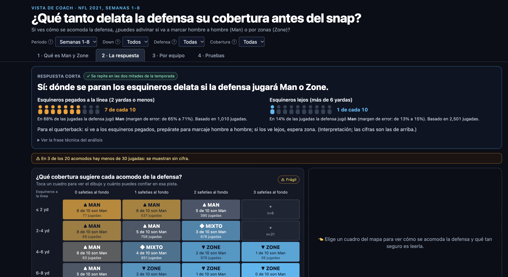

**Si los dos esquineros están pegados a la línea, la defensa jugará Man el 68% de las veces; si están lejos, solo el 14%. La defensa delata su cobertura antes del snap, y aun así el 20% de las jugadas con lectura clara llevan la cobertura contraria.**

# ¿Qué tanto delata la defensa su cobertura antes del snap?



**El hallazgo y cómo lo sabemos.** Un quarterback tiene segundos para adivinar si lo van a marcar hombre a hombre o por zonas, y la respuesta está en dónde se paran los esquineros. Medimos esa posición en el instante exacto del snap, con el tracking de 6,987 jugadas de pase de las semanas 1-8 de 2021, y la cruzamos con la cobertura que PFF registró en cada una. Con esquineros a 2 yardas o menos, la defensa jugó Man en 68.2% de 1,010 jugadas; con más de 6 yardas, en 13.9% de 2,501. Son 54 puntos de diferencia (IC95% 51 a 58). Para no engañarnos, cada jugada se lee con una tabla construida solo con las semanas de la otra paridad, así su propia cobertura nunca influye en su lectura. El resultado se repite en semanas pares e impares (+51 y +58 puntos) y en semanas 1-4 y 5-8 (+54 y +55). Cuando la defensa va contra lo que muestra su alineación ("disfraz"), el equipo ofensivo completa 4.4 puntos menos de pases (51.1% contra 55.5%). También reportamos lo que no se sostuvo: el ranking de equipos que más disfrazan no es estable entre mitades de la temporada, así que no lo publicamos como conclusión.

**Por qué esta pregunta.** Partimos de un banco de 113 preguntas hechas por nosotros previamente (4º y 1, castigos, sacks, lesiones, receptores, pateadores) y las pasamos por el dataset real: 15 eran viables, 52 parciales y 46 imposibles, porque el dato no existe (no hay carreras, goles de campo ni clima). De ahí salieron 8 candidatos de hallazgo. Los mejores, como el reloj del sack o los castigos en pase profundo, eran sólidos pero se parecen a estadísticas que ya se publican. Solo 4 de las 113 preguntas usaban el tracking, y ninguna miraba lo que ocurre antes del snap. Esa fue nuestra apuesta: una pregunta que el banco insinuaba (cobertura individual contra zonal) y que solo este dataset permite responder. Todo el proceso está en [`CLASIFICACION.md`](CLASIFICACION.md).

**Límites.** Una temporada y ocho semanas. Los cortes del análisis salieron de una exploración con las mismas semanas, por eso confirmamos por mitades. La etiqueta Man/Zone es de PFF. Solo vemos el frame del snap, no el movimiento previo. El efecto del disfraz es una asociación, no una causa.

**Correrlo.**
```sh
sh .hackathon/setup.sh
.venv/bin/uvicorn backend.main:app --port 8000   # abre http://localhost:8000
```

